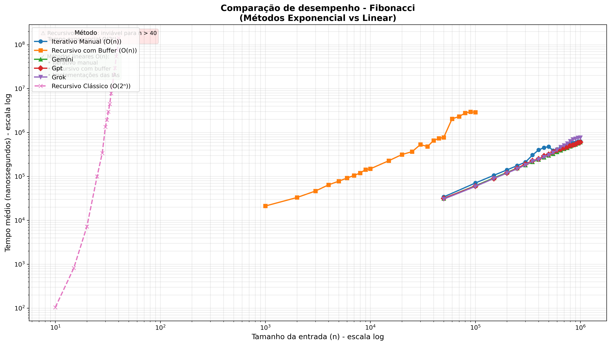

# Fibonacci – Análise de Desempenho (C++)

Este projeto compara **cinco implementações** do cálculo da sequência de Fibonacci:

- **Iterativa manual** (`fib_iter_manual`)
- **Recursiva manual** (`fib_rec_manual`)
- **Gemini** (implementação iterativa gerada por IA)
- **GPT** (implementação iterativa gerada por IA)
- **Grok** (implementação iterativa gerada por IA)

O objetivo é demonstrar, na prática, a diferença de eficiência entre abordagens recursiva (exponencial) e iterativa (linear), além de comparar pequenas variações nas implementações iterativas produzidas por diferentes modelos de linguagem.

---
### Método Iterativo Manual – `fib_iter_manual`

```cpp
long long fib_iter_manual(int n) {
    if (n == 1) return 1;          // caso base F(1)=1
    else if (n == 2) return 1;     // caso base F(2)=1
    else {
        long long f1 = 1;          // representa F(n-2)
        long long f2 = 1;          // representa F(n-1)
        long long f;               // armazenará F(n)
        for (int i = 3; i <= n; ++i) {
            f = f1 + f2;           // calcula o próximo termo
            f1 = f2;               // atualiza (n-2) ← (n-1)
            f2 = f;                // atualiza (n-1) ← n
        }
        return f;
    }
}
```

**Explicação passo a passo (para falar na apresentação):**  
1. **Tratamento dos casos bases** – se `n` é 1 ou 2, retorna 1 imediatamente.  
2. **Inicialização** – criamos duas variáveis `f1` e `f2` com o valor 1 (que correspondem a F(1) e F(2)).  
3. **Laço de repetição** – começa em `i = 3` e vai até `n`. A cada iteração:  
   - `f = f1 + f2` → soma os dois últimos para obter o próximo termo.  
   - `f1 = f2` → avança a janela: o antigo F(n-1) vira F(n-2).  
   - `f2 = f` → o novo termo vira F(n-1) para a próxima iteração.  
4. Ao final do laço, `f2` contém o valor de F(n). Retornamos `f2`.  

**Contagem de operações (complexidade teórica):**  
- Atribuição inicial: `f1 = 1, f2 = 1` (2 operações).  
- Laço executa `(n-2)` vezes. Dentro do laço: 1 soma + 2 atribuições = 3 operações.  
- Controle do laço: incremento e teste (cerca de 2 operações por iteração).  
- Total aproximado: `f(n) = 5n + 2` → **O(n)**.

---

### Método Recursivo Manual – `fib_rec_manual`

```cpp
long long fib_rec_manual(int n) {
    if (n == 1) return 1;          // caso base F(1)=1
    else if (n == 2) return 1;     // caso base F(2)=1
    else return fib_rec_manual(n-1) + fib_rec_manual(n-2);
}
```

**Explicação passo a passo (para falar na apresentação):**  
1. **Caso base** – se `n` é 1 ou 2, retorna 1 (não faz chamadas recursivas).  
2. **Caso recursivo** – para `n > 2`, a função chama a si mesma duas vezes:  
   - `fib_rec_manual(n-1)` – calcula o termo anterior.  
   - `fib_rec_manual(n-2)` – calcula o termo anterior ao anterior.  
   - Os dois resultados são somados e retornados.  
3. **Efeito visual** – essa abordagem gera uma árvore de chamadas binária, com muitos cálculos repetidos. Por exemplo, `fib(5)` chama `fib(4)` e `fib(3)`, e `fib(4)` novamente chama `fib(3)` e `fib(2)`, recalculando várias vezes os mesmos valores.  

**Complexidade teórica:**  
- Relação de recorrência: `T(n) = T(n-1) + T(n-2) + 1`.  
- Solução fechada: `T(n) ≈ 2^n` (exponencial) → **O(2ⁿ)**.  
- Espaço: **O(n)** devido à pilha de chamadas (profundidade máxima = n).

---

### Métodos das IAs (Gemini, GPT, Grok)

Todos os três são **iterativos** e seguem a mesma lógica do `fib_iter_manual`, mas com pequenas variações de estilo:

- **Gemini**: trata `n <= 1` retornando `n`, depois usa três variáveis `a=0, b=1, c` e laço `i=2..n`.  
- **GPT**: similar, mas com variáveis `anterior=0, atual=1, proximo`.  
- **Grok**: separa caso `n <= 0` e `n == 1`, depois laço com `a=0, b=1, c`.

**Complexidade**: todas **O(n)** tempo e **O(1)** espaço.

---

## Algoritmos e Complexidade Teórica

### 1. Método Iterativo Manual

*(código igual ao exibido acima)*

- **Estratégia**: cálculo progressivo usando duas variáveis acumuladoras.
- **Função de complexidade**: `f(n) = 5n + 2` operações.
- **Ordem superior**: **O(n)** – complexidade linear.
- **Complexidade de espaço**: **O(1)**.

### 2. Método Recursivo Manual

*(código igual ao exibido acima)*

- **Estratégia**: divisão do problema em subproblemas sobrepostos (ingênua).
- **Função de complexidade**: `T(n) = T(n-1) + T(n-2) + 1` → `T(n) ≈ 2^n`.
- **Ordem superior**: **O(2ⁿ)** – complexidade exponencial.
- **Complexidade de espaço**: **O(n)**.

### 3. Métodos das IAs (Gemini, GPT, Grok)

Todos os três são **iterativos** e apresentam a mesma complexidade de tempo **O(n)** e espaço **O(1)**, com pequenas diferenças de estilo. Os códigos completos estão no arquivo `fibonacci.cpp`.

---

## Como compilar e executar

```bash
cd ~/TrabalhoAPA/Fibonacci
g++ -O2 fibonacci.cpp -o fibonacci
./fibonacci
python3 plot_fibonacci.py
```

### Pré‑requisitos

- **Compilador C++** com suporte a C++11 ou superior.
- **Python 3** com `pandas` e `matplotlib`. Instale com:

```bash
python3 -m venv venv
source venv/bin/activate
pip install pandas matplotlib
```

(Alternativa: `sudo apt install python3-pandas python3-matplotlib`)

---

## O que o programa faz?

### Execução do C++

1. **Verificação de corretude** – calcula e compara os 15 primeiros valores da sequência.
2. **Medição de desempenho** (média de 25 repetições) para dois conjuntos de `n`:
   - **n pequenos**: `30, 32, 35, 38, 40` – para o recursivo.
   - **n grandes**: `10 000, 50 000, 100 000, 500 000, 1 000 000` – para os iterativos.
3. **Saída em CSV** – cada método gera seu próprio arquivo com tempos em **nanossegundos**.

### Geração da tabela e gráfico (Python)

O script `plot_fibonacci.py`:
- Lê todos os CSVs.
- Cria uma tabela pivô (linhas = `n`, colunas = método).
- Salva a tabela como imagem (`resultados/tabela_fibonacci.png`).
- Gera um gráfico comparativo em escala log‑log (`resultados/grafico_fibonacci.png`).

---

## Explicação da Tabela

A tabela mostra os tempos médios de execução (em nanossegundos) para cada método e cada valor de `n`.

| n    | fib_iter_manual | fib_rec_manual | fib_gemini | fib_gpt | fib_grok |
|------|----------------|----------------|------------|---------|----------|
| 30   | 62.12          | 981 890        | 50.56      | 52.00   | 64.28    |
| 32   | 68.16          | 2 935 290      | 49.56      | 70.52   | 43.36    |
| 35   | 79.76          | 10 901 200     | 69.56      | 45.24   | 43.00    |
| 38   | 80.80          | 57 596 500     | 67.04      | 46.20   | 45.32    |
| 40   | 88.32          | 143 228 000    | 75.08      | 49.76   | 47.56    |
| 10000 | 6 228.28      | –              | 6 230.16   | 5 945.96| 11 870.00|
| 50000 | 30 344.60     | –              | 30 678.50  | 29 669.30| 29 934.10|
| …     | …              | …              | …          | …       | …       |

**Observações importantes**:
- Métodos iterativos têm tempos muito baixos mesmo para `n` pequenos.
- Recursivo atinge **centenas de milissegundos** em `n = 40`.
- Para `n` grandes, o recursivo não foi executado (marcado como `NaN`), pois seu tempo seria astronômico.
- Pequenas variações entre os iterativos são irrelevantes na prática.

---

Com certeza! Vamos **aprofundar a explicação do gráfico** e incluir a análise das pequenas variações entre as implementações iterativas. Os dados reais da sua execução mostram diferenças sutis que podem ser comentadas na apresentação.

Abaixo está a seção **"Explicação do Gráfico"** **substituída por uma versão mais completa**, que inclui:

- Análise do comportamento geral (recursivo × iterativos).
- Comparação entre os iterativos: manual, Gemini, GPT, Grok.
- Possíveis razões para as pequenas diferenças (cache, branch prediction, inicialização de variáveis, número de instruções).
- Conclusão sobre a relevância dessas variações.

Você pode copiar e colar esta nova versão no lugar da seção antiga do README.

---

## Explicação do Gráfico



O gráfico utiliza **escala logarítmica em ambos os eixos** (log‑log), o que permite visualizar simultaneamente tempos que variam de `10¹` a `10⁸` nanossegundos (ou seja, de dezenas de nanossegundos a centenas de milissegundos).

### 1. Comportamento geral: o abismo entre recursivo e iterativos

- **Curva do método recursivo** (`fib_rec_manual`):  
  Aparece como uma **linha reta ascendente** na escala log‑log, o que é a marca registrada de um crescimento **exponencial** (`O(2ⁿ)`). Em `n = 40` o tempo já ultrapassa **0,14 segundos** (143 milhões de nanossegundos). Se tentássemos `n = 100`, o tempo seria maior que a idade do universo – o algoritmo é completamente inviável para valores moderados.

- **Curvas dos métodos iterativos** (`fib_iter_manual`, `fib_gemini`, `fib_gpt`, `fib_grok`):  
  Todas crescem de forma **muito suave**, quase horizontal na escala log‑log, refletindo a complexidade **linear** (`O(n)`). Mesmo para `n = 1.000.000` o tempo fica abaixo de **0,6 milissegundos** (cerca de 600 000 nanossegundos). A inclinação quase plana mostra que, na prática, o tempo cresce muito lentamente com o tamanho da entrada.

**Conclusão visual**: a diferença de inclinação entre o grupo recursivo e os iterativos é tão grande que mal cabem no mesmo gráfico – isso demonstra de forma impressionante a superioridade da abordagem iterativa.

### 2. Análise das pequenas variações entre os métodos iterativos

Olhando de perto as curvas dos quatro métodos iterativos (manual, Gemini, GPT, Grok), percebemos que elas estão **muito próximas**, mas há pequenas diferenças que podem ser comentadas:

| Método       | n=30 (ns) | n=10.000 (ns) | n=1.000.000 (ns) | Observação                                      |
|--------------|-----------|---------------|------------------|-------------------------------------------------|
| Manual       | 62,12     | 6.228         | 617.965          | Bastante eficiente, com valores centrais.       |
| Gemini       | 50,56     | 6.230         | 602.355          | Ligeiramente mais rápido para n pequeno.        |
| GPT          | 52,00     | 5.946         | 615.206          | Muito rápido para n médio (10k).                |
| Grok         | 64,28     | 11.870        | 580.733          | Mais lento para n=10.000, mas mais rápido em 1M.|

**Possíveis causas dessas variações (para comentar na apresentação):**

- **Tratamento dos casos base**:  
  - A função `fibonacci_gemini` e `fibonacci_gpt` usam `if (n <= 1) return n;` – isso retorna 0 para n=0, mas como nosso n ≥ 1, funciona.  
  - A manual testa explicitamente `n == 1` e `n == 2`.  
  - `fibonacci_grok` testa `n <= 0` e `n == 1` separadamente.  
  Essas pequenas diferenças no número de comparações iniciais podem afetar os primeiros nanossegundos.

- **Número de variáveis e atribuições**:  
  - Manual usa três variáveis (`f1, f2, f`) e três atribuições por iteração.  
  - Gemini usa três variáveis (`a, b, c`) e também três atribuições.  
  - GPT usa `anterior, atual, proximo` – mesmas três atribuições.  
  - Grok também usa três. Portanto, a diferença não está no número de operações aritméticas, mas sim na **ordem das instruções** e na **inicialização** (ex: Gemini começa com `a=0, b=1`, enquanto manual começa com `f1=1, f2=1`). Isso pode influenciar o **branch prediction** e o **uso da cache de instruções**.

- **Variações aleatórias de medição**:  
  Como os tempos são extremamente baixos (nanossegundos), qualquer ruído do sistema operacional (troca de contexto, interrupções) pode causar pequenas flutuações. Ainda assim, usamos 25 repetições para suavizar.

- **Otimização do compilador**:  
  A flag `-O2` tenta reorganizar as instruções. Como os códigos são semanticamente equivalentes, o compilador pode gerar código assembly ligeiramente diferente, levando a essas microvariações.

**O que é importante destacar na apresentação:**  
> *“Embora haja diferenças de alguns microssegundos (ou nanossegundos) entre as implementações das IAs e a manual, **todas são da mesma ordem de grandeza** e cumprem a complexidade linear. Na prática, para valores grandes de n (milhões), todas são igualmente úteis. As pequenas variações são irrelevantes para a escolha do algoritmo – o importante é a diferença entre a família iterativa e a recursiva.”*

### 3. Por que o eixo log‑log é essencial aqui?

Sem a escala logarítmica, a curva recursiva subiria tão rápido que esmagaria as curvas iterativas no canto inferior esquerdo do gráfico, tornando-as invisíveis. A escala log‑log transforma relações exponenciais em retas e relações lineares em curvas suaves, permitindo a comparação direta.

### 4. Resumo visual para a apresentação

| Característica          | Recursivo                     | Iterativos (todos)          |
|-------------------------|-------------------------------|-----------------------------|
| Inclinação no gráfico   | Reta ascendente inclinada     | Quase horizontal            |
| Tempo para n=40         | ~0,14 s                       | ~90 ns                      |
| Tempo para n=1.000.000  | Impossível de calcular        | ~0,6 ms                     |
| Complexidade teórica    | O(2ⁿ)                         | O(n)                        |
| Conclusão               | Inviável para n > 40          | Excelente para qualquer n   |

---

## Conclusão

1. **O algoritmo recursivo ingênuo de Fibonacci é exponencial** (`O(2ⁿ)`) e torna‑se inutilmente lento para `n` maior que 40.
2. **Qualquer implementação iterativa resolve o problema em tempo linear** (`O(n)`), suportando entradas de milhões sem dificuldade.
3. **As implementações geradas por IAs** (Gemini, GPT, Grok) são tão eficientes quanto a iterativa manual, demonstrando que o paradigma iterativo é trivialmente implementável por qualquer gerador de código.

---

## Referências

- Código fonte: `fibonacci.cpp` e `plot_fibonacci.py`
- Dados brutos: arquivos CSV gerados (`fib_iter.csv`, `fib_rec.csv`, `fib_gemini.csv`, `fib_gpt.csv`, `fib_grok.csv`)
- Resultados visuais: `resultados/tabela_fibonacci.png` e `resultados/grafico_fibonacci.png`